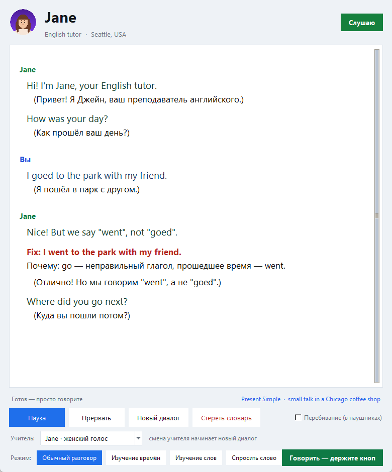

# English Tutor — Джон из Чикаго

Голосовой тренажёр разговорного английского для русскоязычного ученика. Приложение
работает как живой собеседник: микрофон слушается постоянно, вы просто говорите —
Джон отвечает голосом, а в окне каждая фраза идёт вместе с переводом на русский.



---

## Что это такое

Не чат и не учебник, а **разговор один на один с «учителем»-американцем**:

- **Без кнопок «начать запись»** — Silero VAD сам находит начало и конец вашей фразы.
  Захотите — перебейте Джона на полуслове, он замолчит и выслушает.
- **Кнопка «Говорить», если думаете над фразой.** Держите её — приложение не решит, что вы
  закончили, сколько бы вы ни молчали; отпустили — фраза целиком уходит в распознавание.
- **Двуязычные реплики.** Каждая английская строка (ваша, Джона и даже `Fix:`) идёт вместе
  с переводом на русский в скобках чёрным шрифтом. Если модель забудет перевод, программа
  допереводит недостающие строки сама и вставит их на нужное место.
- **Живой человек, а не шаблон.** Джон живёт в Чикаго, шутит, спорит, рассказывает
  истории из своей жизни и задаёт один открытый вопрос за реплику. Он не прыгает по
  темам: сначала реагирует на ваш ответ, добавляет что-то от себя, а потом задаёт
  уточняющий вопрос о том же. Разговор идёт на живые темы (еда, путешествия, фильмы,
  деньги, питомцы, детство, «а что если…»), а не по анкете. Всё это — системный промпт.
- **Два учителя на выбор: John или Jane.** Мужской или женский голос, разные города и
  характер; переключается в окне, выбор запоминается на следующий запуск.
- **Ошибки исправляются, и разговор ждёт правильного повтора.** Если вы ошиблись,
  Джон отвечает только блоком `Fix:` — исправленная фраза, её перевод, `Почему:`
  (короткое объяснение по-русски) и просьба повторить. Никаких реакций и новых вопросов,
  пока вы не скажете исправленную фразу правильно. Повторили — похвалил и продолжил.
- **Тренируются времена, сценарии и бытовые темы.** Программа сама ведёт учебный план:
  14 времён и конструкций × 20 бытовых сцен (кафе, аэропорт, аптека, врач, отель,
  аренда квартиры…) × 18 бытовых тем для болтовни. Фокус меняется каждые 6 ваших
  реплик и показан внизу окна.
- **Режим «Изучение времён».** Кнопка внизу включает тренажёр: на экране появляется русская
  фраза («Я иду на работу прямо сейчас»), диктор коротко называет время, а вы отвечаете
  по-английски. Под фразой — короткая подсказка-формула; кнопка режима становится
  фиолетовой. 12 времён, по две фразы на каждое; ошибка — только `Fix:`, короткое
  `Почему:` и `Say it again.` Фразы генерируются заново при каждом запуске режима,
  поэтому одни и те же предложения не повторяются.
- **Режим «Изучение слов».** Третья кнопка режима: учитель просто произносит русское слово
  или фразу из словаря, а на экране появляется русское слово. Вы
  говорите английский вариант. Для русского слова используется отдельный голос Piper
  `ru_RU-irina-medium` (скачается при первом слове). Программа считает повторы и ошибки,
  а слова с ошибками возвращает чаще по правилу забывания (через 2 минуты, потом раз в день).
  Если слово не распознаётся, нажмите «Подсказка» (или скажите «Подсказка») — учитель
  покажет первую букву, потом две, потом всё слово. Скажите «Следующее слово» или нажмите
  кнопку, чтобы пропустить слово; после трёх неудач оно пропускается само. Одно и то же
  слово не спрашивается два раза подряд. Если новые слова в текущей порции закончились,
  тренажёр ждёт, пока фоновая порция добавится, и продолжает с новыми; если добавить не
  удалось — заканчивается. Если словарь пуст или в нём меньше пяти слов, тренажёр
  придумывает новый диалог и берёт слова из него; следующая порция добирается в фоне
  автоматически. Кнопка «Добавить слова» запускает подбор ещё одной порции вручную.
  Кнопка режима становится зелёной.
- **Режим «Спросить слово».** Четвёртая кнопка: удерживайте «Говорить» и спросите
  по-русски, как сказать слово («как сказать подушка?»). Учитель ответит по-английски
  («pillow») и вернёт разговор на то же место. Кнопка режима становится оранжевой.
- **Словарь новых слов.** Учитель сам добавляет в словарь новые полезные слова и фразы
  (`Word: commute — ездить на работу`), они сохраняются в `tutor_memory/vocabulary.json`
  и подмешиваются в промпт, чтобы слова постепенно запоминались. Памяти прошлых
  разговоров больше нет — только словарь.
- **Всё локально.** Ничего не уходит в интернет: Ollama, Whisper и озвучка работают на
  вашей машине.

---

## Как это работает

```
микрофон 16 кГц
   │  (звук идёт блоками по 512 отсчётов)
   ▼
Silero VAD ── находит начало и конец фразы, копит «предбуфер» перед речью
   │
   ▼
faster-whisper (large-v3-turbo) ── распознаёт английскую речь
   │
   ▼
Ollama · gemma3:12b ── отвечает по-английски + перевод в скобках + Fix/Почему,
   │                    стримом, по предложению
   ▼
Piper TTS ── озвучивает только английские строки, по фразе за раз
```

Особенности реализации:

- **Стриминг по предложениям.** Джон начинает говорить, не дожидаясь конца ответа:
  каждая готовая фраза сразу уходит в озвучку.
- **Перебивание (по умолчанию выключено).** Включается галочкой «Перебивание (в наушниках)».
  Пока Джон говорит, микрофон продолжает слушать; если вы заговорили дольше 0,35 с —
  генерация и озвучка обрываются (`sd.stop()`), и он слушает вас.
- **Края фраз.** Piper обрывает звук на ненулевом уровне, поэтому к каждой фразе
  добавляются плавные края 15 мс и хвост тишины 250 мс — окончания слов не «щёлкают».
- **Словарь в файлах.** Каждое новое слово сразу пишется в `vocabulary.json` и
  подхватывается при следующем запуске.
- **Чёткий интерфейс.** Tkinter + Segoe UI, светлая тема, DPI-awareness (на мониторе с
  масштабированием 125–150 % текст остаётся резким).

---

## Что нужно для запуска

| Требование | Детали |
|---|---|
| ОС | Windows 10/11 (проверено). Программа рассчитана на Windows: поиск DLL для CUDA, `windll` для DPI, пути к голосам. На Linux/macOS потребуются правки |
| Python | 3.10+ (проверено на 3.13.14) |
| [Ollama](https://ollama.com/download) | Локальный сервер моделей; скрипт сам поднимет `ollama serve`, если он не запущен |
| Модель | `gemma3:12b` (~8,2 ГБ). Скачается автоматически при первом запуске |
| Видеокарта | NVIDIA с 8–12 ГБ VRAM для комфортной скорости (проверено на RTX 5060 Ti 16 ГБ). Меньше — будет медленнее, но работать будет |
| Звук | Микрофон и наушники. **Наушники обязательны для перебивания голосом**: с колонками микрофон слышит Джона и обрывает его |
| Диск | ~12 ГБ: модель 8,2 ГБ + Whisper 1,6 ГБ + голос 0,2 ГБ + CUDA-библиотеки 1,2 ГБ + пакеты Python |

Первый запуск занимает несколько минут: скачиваются модель Ollama, модель Whisper и голос Piper.

---

## Запуск

```bash
python english_tutor_memory.py
```

Скрипт сам:

1. проверит и поставит недостающие pip-пакеты;
2. запустит `ollama serve`, если сервер не отвечает;
3. скачает модель `gemma3:12b`, если её нет;
4. скачает голос Piper `en_US-ryan-high` (~120 МБ) и CUDA-библиотеки для Whisper
   (`nvidia-cublas-cu12`, `nvidia-cudnn-cu12`, ~1,2 ГБ) — один раз;
5. загрузит Whisper и Silero VAD, загрузит словарь;
6. скажет «Hi! What do you want to talk about?» и начнёт слушать.

Дальше — просто говорите вслух. Пауза 0,7 с означает «фраза закончена».

### Кнопки

| Кнопка | Что делает |
|---|---|
| **Обычный разговор** | Свободный чат с учителем (синяя кнопка, когда режим включён) |
| **Изучение времён** | Тренажёр 12 времён (фиолетовая кнопка, когда режим включён) |
| **Изучение слов** | Тренажёр слов из словаря (зелёная кнопка, когда режим включён) |
| **Спросить слово** | Удерживайте «Говорить» и спросите по-русски — учитель скажет английское слово (оранжевая кнопка, когда режим включён) |
| **Говорить — держите кнопку** | Пока кнопка нажата, пауза в речи не считается концом фразы. Отпустили — фраза ушла в распознавание. Если Джон в этот момент говорит, он умолкает |
| **Пауза / Продолжить** | Выключает и включает микрофон |
| **Прервать** | Обрывает текущий ответ Джона (то же, что перебить голосом) |
| **Новый диалог** | Очищает окно и начинает новое занятие |
| **Стереть словарь** | Удаляет все сохранённые слова |
| **Перебивание (в наушниках)** | Разрешает/запрещает прерывать Джона голосом |

### Когда пользоваться кнопкой «Говорить»

Обычный режим hands-free: договорили — 0,7 с тишины — фраза ушла в работу. Если вы
задумались посреди предложения (подбираете слово, время глагола), пауза будет принята за
конец фразы. Тогда:

1. нажмите и **держите** зелёную кнопку;
2. говорите не спеша, делайте любые паузы — приложение продолжает записывать;
3. отпустите кнопку — Джон получит всю фразу целиком.

### Выбор учителя: John или Jane

Внизу окна селектор **«Учитель»**:

| | John | Jane |
|---|---|---|
| Портрет | `avatar_john.png` | `avatar_jane.png` |
| Голос | мужской, `en_US-ryan-high` | женский, `en_US-lessac-high` |
| Город | Chicago, USA | Seattle, USA |
| Характер | 38 лет, суховатый юмор | 34 года, тёплая и любопытная |

Переключение сразу меняет портрет и имя в шапке, голос и промпт, очищает окно и начинает
новый диалог — новый учитель здоровается первым. Выбор сохраняется в `tutor_settings.json`
и подхватывается при следующем запуске. Словарь общий: Jane и John используют одни и те же
слова.

Свой персонаж добавляется одной строкой в `PERSONAS` (имя, возраст, город, пол и две
модели голоса), менять код больше нигде не нужно.

**Свой портрет.** Аватары нарисованы для приложения (`make_avatars.py`), но их легко
заменить фотографией: положите рядом с программой квадратную картинку с именем
`avatar_john.png` или `avatar_jane.png` (PNG, лучше 256×256, круглый край — на ваш вкус).
Она подхватится при следующем запуске. Если файла нет — в шапке будет первая буква имени.

### Копирование текста

Окно только для чтения, но текст из него копируется:

- выделите мышью нужный фрагмент и нажмите **Ctrl+C** (или **Ctrl+A** — выделить всё);
- **правая кнопка мыши** → «Копировать», «Копировать весь диалог», «Выделить всё».

Ввод с клавиатуры и вставка в окно заблокированы — испортить переписку нельзя.

---

## Использованные библиотеки

Всё ставится автоматически в `site-packages` при первом запуске.

| Пакет | Версия | Зачем |
|---|---|---|
| `ollama` | 0.6.3 | Python-клиент к локальному серверу Ollama: стриминговые ответы модели, проверка ответов в тренажёре |
| `faster-whisper` | 1.2.1 | Распознавание речи (CTranslate2-реализация Whisper), модель `large-v3-turbo` |
| `ctranslate2` | 4.8.5 | Движок инференса под faster-whisper (CUDA или CPU) |
| `silero-vad` | 6.2.3 | Детектор речи: находит начало и конец фразы, отсекает тишину и щелчки |
| `torch` | 2.15.0 (CPU-сборка) | Нужен Silero VAD (сам VAD считает на CPU — это дёшево) |
| `piper-tts` | 1.8.0 | Синтез речи по умолчанию, голос `en_US-ryan-high` (мужской американский) |
| `onnxruntime` | 1.31.1 | Движок инференса под Piper |
| `sounddevice` | 0.5.6 | Ввод с микрофона и вывод звука (PortAudio) |
| `numpy` | 2.5.4 | Аудиобуферы, склейка и обработка звука |
| `tkinter` | Tk 8.6 | Графический интерфейс (входит в Python для Windows) |
| `nvidia-cublas-cu12`, `nvidia-cudnn-cu12` | 12.9 / 9.28 | CUDA-библиотеки для Whisper на GPU; без них распознавание тихо уходит на CPU |

Разово, вне Python: **Ollama** (0.40.14) и модель **`gemma3:12b`**.

### Альтернативная озвучка

`TTS_ENGINE = "kokoro"` в настройках включит Kokoro (`af_heart` → замените на
`am_michael` для мужского голоса). Если движок не запустился, приложение само
переключится на второй.

---

## Настройки

Все параметры — константы в начале файла.

### Модель и распознавание

```python
OLLAMA_MODEL = "gemma3:12b"     # любая модель Ollama
WHISPER_MODEL = "large-v3-turbo"
WHISPER_LANGUAGE = "en"         # None - автоопределение
OPTIONS = {"temperature": 0.7, "num_ctx": 8192}
HISTORY_TURNS = 16              # сколько реплик диалога видит модель
WHISPER_USE_CUDA = True         # False - распознавать на CPU
```

Замеры с этим промптом (RTX 5060 Ti 16 ГБ) — записаны и в комментарии к `OLLAMA_MODEL`:

| Модель | Скорость | Весь ответ | Ошибки находит |
|---|---|---|---|
| `gemma3:12b` | 46 ток/с | ~2,5 с | 5 из 5 |
| `gemma3:4b` | 108 ток/с | ~0,8 с | 2 из 5 (почти не пишет Fix) |
| `qwen3:8b` | 70 ток/с | ~1,5 с | путает формат «фраза + перевод» |
| `qwen2.5:7b` | 62 ток/с | ~1,9 с | тоже не держит формат |

Вывод: для этого приложения лучше остаётся `gemma3:12b`.

### Учитель и голос

```python
PERSONAS = {
    "john": dict(name="John", age=38, home="Chicago, USA", voice="мужской", sex="man",
                 piper="en_US-ryan-high", kokoro="am_michael"),
    "jane": dict(name="Jane", age=34, home="Seattle, USA", voice="женский", sex="woman",
                 piper="en_US-lessac-high", kokoro="af_heart"),
}
PERSONA_DEFAULT = "john"    # если файла настроек ещё нет
```

Чтобы добавить своего учителя, допишите элемент в `PERSONAS` — имя, возраст, город, пол
(`sex`) и два голоса. Он сразу появится в селекторе; скачивание нового голоса Piper
(~120 МБ) произойдёт при первом переключении.

```python
TTS_TAIL_S = 0.25                # тишина после фразы (страховка от обрыва окончаний)
TTS_FADE_S = 0.015               # плавные края, чтобы не было щелчка
```

### Микрофон и перебивание

```python
VAD_THRESHOLD = 0.5      # выше - строже к шуму
SILENCE_MS = 700         # пауза, после которой фраза считается законченной
MIN_UTTER_S = 0.5        # фразы короче игнорируются
BARGE_IN_DEFAULT = False # перебивание выключено по умолчанию (включайте в наушниках)
BARGE_MIN_S = 0.35       # сколько нужно говорить, чтобы прервать ответ
```

### Учебный план

```python
FOCUS_TURNS = 6    # сколько реплик длится один фокус
TENSES = [...]     # 14 времён и конструкций
SCENARIOS = [...]  # 20 сцен
```

### Словарь

```python
VOCAB_IN_PROMPT = 60      # сколько последних слов показывать учителю в промпте
```

### Внешний вид

```python
FONT = "Segoe UI"
FONT_BODY = 14     # английские реплики
FONT_SUB = 13      # переводы и пояснения
BG = "#eef2f6"     # фон окна
CARD = "#ffffff"   # карточка диалога
```

---

## Файлы и папки

```
english_tutor_memory.py   сама программа (один файл)
ui_preview.png            скриншот интерфейса
avatar_john.png           портрет учителя (можно заменить своим)
avatar_jane.png           портрет учительницы (можно заменить своим)
make_avatars.py           скрипт, которым нарисованы аватары
make_preview.py           пересъёмка ui_preview.png (демо-диалог без микрофона)
piper_voices/             голоса Piper (по ~120 МБ на голос)
tutor_memory/
  vocabulary.json         словарь новых слов
tutor_settings.json       выбранный учитель (John / Jane)
tutor_debug.log           диагностика звука (можно отключить: DEBUG_LOG = False)
```

Словарь можно удалить кнопкой «Стереть словарь» или просто убрав `tutor_memory/vocabulary.json`.
Старые файлы `sessions/`, `summaries.json` и `long_term.json` больше не используются — их можно удалить.

---

## Словарь: как это устроено

1. **Новое слово.** Когда в разговоре появляется полезное новое слово или фраза, учитель
   добавляет в конце ответа строку `Word: <английский> — <перевод>`.
2. **Сохранение.** Программа сразу пишет слово в `tutor_memory/vocabulary.json` и
   показывает его в окне зелёным.
3. **Повторение.** В режиме «Изучение слов» учитель просто произносит русское слово,
   на экране — это же слово; вы говорите английский вариант.
   Каждый ответ увеличивает счётчик повторов; ошибки записываются отдельно.
4. **Правило забывания.** Слово с ошибкой возвращается через 2 минуты, затем раз в день,
   пока не будет уверенно повторено. Слова без ошибок повторяются всё реже: 1, 2, 4, 8,
   16, 30 дней. Последние 60 слов попадают в промпт, чтобы учитель использовал их в
   разговоре.
5. **Памяти прошлых разговоров нет** — учитель не ссылается на старые беседы, только
   на словарь.
6. **Спросить слово.** В режиме «Спросить слово» удерживайте «Говорить» и задайте
   вопрос по-русски — учитель скажет английский вариант и вернёт разговор на место.
7. **Новые слова из диалогов.** Если словарь пуст или в нём меньше пяти слов, тренажёр
   просит модель придумать новый диалог на ещё не пройденную тему и берёт из него слова.
   Если модель недоступна, используется встроенный банк `WORD_BANK`. Кнопка «Добавить
   слова» в режиме слов запускает тот же подбор.

---

## Если что-то не работает

| Симптом | Причина и что делать |
|---|---|
| `Ollama не отвечает` | Не установлена или занят порт 11434. Запустите `ollama serve` вручную |
| Ответы очень медленные | Модель не влезла в VRAM (проверьте `ollama ps` — должно быть `100% GPU`) или долгий простой: `KEEP_ALIVE = "30m"` выгружает модель через полчаса |
| «Не расслышал» на каждую фразу | Проверьте микрофон в системе; уменьшите `VAD_THRESHOLD` до 0.3 |
| Пауза посреди фразы обрывает её | Так работает hands-free: 0,7 с тишины = конец фразы. Держите кнопку **🎙 Говорить**, пока подбираете слова (или увеличьте `SILENCE_MS`) |
| Джон обрывает сам себя | Слушаете через колонки — снимите галочку «Перебивание» или наденьте наушники |
| Первая фраза обрывается на первом слове | Приложение приняло щелчок/шум за вашу речь и «перебило» само себя. Уже защищено: перебивание требует 0,35 с **громкого** звука и не работает во время приветствия. Если повторится — пришлите `tutor_debug.log`: там видно, что случилось (`vad start`, `barge-in`, `say`/`say end`, ошибки) |
| Обрываются окончания слов | Увеличьте `TTS_TAIL_S` до 0.4 |
| `Whisper на GPU не запустился` | Нет CUDA-библиотек: `pip install nvidia-cublas-cu12 nvidia-cudnn-cu12`, либо `WHISPER_USE_CUDA = False` |
| Распознавание путает акцент | `WHISPER_LANGUAGE = "en"` уже стоит; поставьте `None` только для тестов |
| Окно мелкое/крупное | Интерфейс учитывает масштабирование Windows; размер — `root.geometry` в `App.__init__` |

---

## Управление форматом ответа (для справки)

Приложение разбирает текст модели по строкам, поэтому формат жёстко задан в промпте:

```
(перевод вашей последней фразы)
English sentence
(перевод этой фразы)
Fix: исправленная фраза        ← только если была ошибка
(перевод исправления)
Почему: объяснение по-русски   ← только если была ошибка
Now say it once more, please.  ← просьба повторить, только после Fix
(перевод просьбы)
```

Вслух читаются только английские строки (и `Fix:` — как «Better: …»). Если у какой-то
английской строки перевода не оказалось, приложение само допереводит её отдельным
запросом и вставляет перевод сразу под строкой — так что без перевода не остаётся
ни одна фраза.
